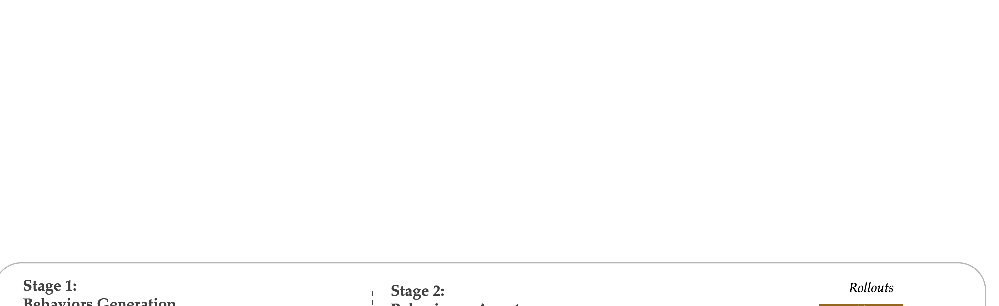

<div align="center">

# PopGen

**Generating diverse teammate populations for zero-shot coordination**

[](https://www.python.org/downloads/)
[](https://github.com/astral-sh/uv)
[](https://github.com/astral-sh/ruff)

</div>

<p align="center">
  
</p>

PopGen turns a natural-language description of an environment into a **population of
behaviorally distinct agents**, then uses that population to train a cooperator (ego agent)
that generalizes to unseen partners.

It runs in two stages. **Stage 1** oversamples candidate behaviors from an LLM and filters
them down to a diverse final set. **Stage 2** compiles each behavior into an executable
agent — policy code, an RL reward function, or an LLM agent — and iterates on it with
feedback from a VLM evaluator that scores how well rollouts actually match the intended
behavior.

## Features

- **Three generation pipelines** — Python policy code, RL reward functions (trained via BenchMARL), or prompt-configured LLM agents.
- **Diversity strategies** — direct, stratified, verbalized sampling, and multi-turn verbalized sampling.
- **Closed-loop evaluation** — adherence, diversity, and quality evaluators feed an advisor that revises failing agents.
- **Cooperator training** — train an ego agent against a generated population, with self-play and FCP baselines for comparison.
- **Seven environments** — Level-Based Foraging, Overcooked, Google Research Football, Predator-Prey (`pp`, `pp_stag`), Point-Mass Rendezvous, and SMACv2.
- **Provider-agnostic LLMs** — every model call goes through LiteLLM, so OpenAI, Anthropic, OpenRouter, and self-hosted vLLM endpoints are interchangeable.

## Quick Start

```bash
# 1. Install
uv sync

# 2. Add provider keys
cp .env.example .env   # then fill in OPENAI_API_KEY / ANTHROPIC_API_KEY / ...

# 3. Generate a population on Level-Based Foraging
cd scripts/population
./run_pipeline.sh env=lbf generation=policy_code
```

This generates behaviors, compiles each into policy code, evaluates the rollouts, and
writes a results CSV under `results/lbf/policy_code/<model>/`.

<details>
<summary>Alternative: editable pip install</summary>

```bash
pip install -e .
pip install -e deps/VectorizedMultiAgentSimulator
pip install -e deps/BenchMARL
pip install -e deps/lb-foraging
```

</details>

SMACv2 needs a separate StarCraft II installation — see [docs/setup_smacv2.md](docs/setup_smacv2.md).

## Usage

### Population generation

```bash
cd scripts/population
./run_pipeline.sh env=lbf generation=policy_code   # or rl_reward / llm_agent
```

Or step by step:

```bash
python generate_behaviors.py env=lbf n_behaviors=5
python generate_agents.py env=lbf generation=policy_code behavior_path=./data/behaviors/lbf.json
python gather_results.py ./results/lbf/policy_code/<model> -o results.csv
```

### Cooperator training

```bash
cd scripts/cooperator
./run_experiments.sh env=lbf n_behaviors=8                      # population → cooperator → evaluation
./run_cooperator.sh env=lbf population_dir=/path/to/population  # cooperator on an existing population
```

### Baselines

```bash
cd scripts/self-play && ./run_experiments.sh env=pp_stag
cd scripts/fcp && python main.py
```

## Configuration

All scripts are Hydra entry points; configs live in `cfg/` next to each script and are
overridable on the command line.

| Key | Purpose |
|-----|---------|
| `env` | Environment name, resolved to `popgen/envs/<env>/` |
| `generation` | `policy_code`, `rl_reward`, or `llm_agent` |
| `behavior` | Diversity strategy: `verbalized_sampling`, `stratified`, `in_context`, … |
| `generation.model_name` | Generator model, in LiteLLM naming (e.g. `anthropic/claude-sonnet-4-5`) |
| `evaluation.evaluator_model` | LLM-as-judge model for adherence scoring |
| `n_behaviors`, `n_trials`, `n_workers` | Population size, retries per behavior, parallelism |

```bash
python generate_agents.py env=overcooked generation=rl_reward n_behaviors=8 n_workers=4
```

Results are written to `results/${env}/...`; see [docs/output_layout.md](docs/output_layout.md).

## Project Structure

```text
popgen/
  population/    behavior generation strategies, evaluators, feedback loop
  agents/        PolicyCodeAgent, LLMAgent, multi-policy routers
  cooperator/    cooperator training pipeline and evaluation
  envs/          per-environment descriptions, rollout/train functions, RL configs
scripts/
  population/    behavior → agent → CSV harness
  cooperator/    cooperator training and cross-evaluation
  self-play/     self-play baseline
  fcp/           Fictitious Co-Play baseline
```

## Documentation

| Document | Contents |
|----------|----------|
| [add_env.md](docs/add_env.md) | Adding a new environment |
| [agents.md](docs/agents.md) | Agent wrappers and routers |
| [llm_usage.md](docs/llm_usage.md) | LiteLLM configuration and model selection |
| [setup_smacv2.md](docs/setup_smacv2.md) | StarCraft II / SMACv2 installation |
| [output_layout.md](docs/output_layout.md) | Result directory structure |
| [evaluation_json_format.md](docs/evaluation_json_format.md) | Evaluation file schema |
| [evaluators/diversity_discriminator.md](docs/evaluators/diversity_discriminator.md) | Diversity discriminator evaluator |

## Development

```bash
uv sync --extra dev
uv run pytest tests/ -v
uv run ruff check . && uv run ruff format .
```
